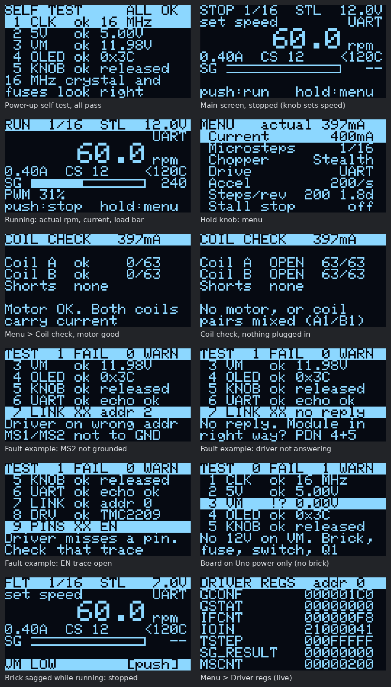

# Universal Stepper Tester

A bench tool for NEMA 17 and smaller bipolar stepper motors: plug a motor in, spin it, set current and microstepping, and read the driver's own diagnostics on an OLED. Every power-up runs a self test that names the failing part of the board. By -DK.

| | |
|---|---|
| MCU | ATmega328P (DIP-28, socketed), 16 MHz crystal, ISP-programmed, no bootloader |
| Driver | BigTreeTech TMC2209 V1.2 StepStick, single-wire UART, up to about 1.75 A RMS |
| UI | 0.96 in SSD1306 I2C OLED, EC11 encoder with push, on a separate front board |
| Power | 12 V brick, inline 2 A blade fuse, panel switch, reverse-polarity FET, L7805 |
| Boards | Rev A: main 100.6 x 89.0 mm + front 70.0 x 38.1 mm, 2 layers, one JLCPCB panel |
| Firmware | v1.0 (2026-10-12), no libraries, verified in a board simulator (sizes in `CLAUDE.md`) |

## Status

Rev A boards are built and the first one powers up; the motor only vibrates so far, and the real-hardware self test still has to be recorded. Details and open issues: **[STATUS.md](STATUS.md)**.

## Repository

| Path | What |
|---|---|
| [`STATUS.md`](STATUS.md) | current state, active thread, queue, open items |
| [`CHANGELOG.md`](CHANGELOG.md) | history |
| [`CLAUDE.md`](CLAUDE.md) | rules and session protocol for working on this with Claude |
| [`docs/hardware.md`](docs/hardware.md) | design reference: power path, pin map, connectors, BOM, layout rules, display options |
| [`docs/errata-rev-a.md`](docs/errata-rev-a.md) | known Rev A problems, workarounds, Rev B candidates |
| [`docs/assembly.md`](docs/assembly.md) | build order, first power-up, harnesses, ribbon, motor wiring |
| [`docs/firmware.md`](docs/firmware.md) | self test, controls, menu, faults, debug log, backlog |
| [`docs/build-and-flash.md`](docs/build-and-flash.md) | MiniCore, Uno as ISP, fuses, expected warnings |
| [`docs/decisions.md`](docs/decisions.md) | why the design is the way it is |
| [`docs/inventory.md`](docs/inventory.md) | parts the owner has stated outside his inventory file, and the buy list (the inventory file itself is in the claude.ai Project knowledge) |
| [`docs/history/`](docs/history/) | sources, the 2026-10-06 progress doc |
| [`docs/claude-project-instructions.md`](docs/claude-project-instructions.md) | text for the claude.ai Project's instructions field |
| [`docs/seeds.md`](docs/seeds.md) | opening message for the next thread |
| [`firmware/`](firmware/) | `stepper_tester/` (the board firmware), `bringup/` (old Uno breadboard sketches) |
| [`tools/`](tools/) | `build.sh` headless build, `sim/` board simulator with fault scenarios |
| [`hardware/`](hardware/) | Rev A KiCad project and production files, as ordered |

## Flash the firmware (short version)

1. Arduino IDE: add the MiniCore URL in Preferences, install **MiniCore** from Boards Manager.
2. Upload ArduinoISP to an Uno, then 10 uF from its RESET to GND.
3. Tools: MiniCore ATmega328, External 16 MHz, BOD 2.7V, EEPROM retained, LTO enabled, 328P / 328PA, No bootloader, Programmer "Arduino as ISP".
4. Wire the Uno to the chip (breadboard jig or J2), Burn Bootloader once per chip, then Sketch > Upload Using Programmer.

Full procedure and what the warnings mean: [`docs/build-and-flash.md`](docs/build-and-flash.md).

## Safety

- Never plug or unplug a motor with 12 V on.
- J1 pin 1 is **negative**.
- J3 (ISP PWR) off whenever the brick is plugged in.
- Keep the input at 9 to 14 V while the 15 V zener (D1) is fitted.

## Working on it

The repo is the source of truth. Work in small commits (`fw:`, `hw:`, `docs:`, `tools:`), keep `STATUS.md` current, tag firmware releases `fw-vX.Y` and ordered boards `hw-rev-X`. Firmware changes must pass `tools/build.sh` and `tools/sim/run_all.sh` before they go on a chip. Details in [`CLAUDE.md`](CLAUDE.md).
