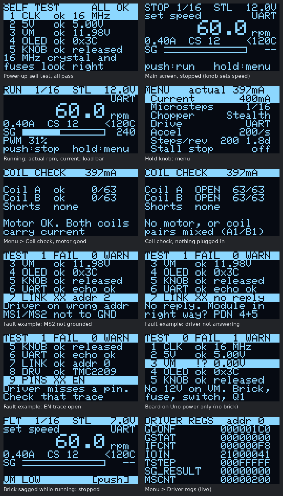

# Firmware reference (v1.0)

`firmware/stepper_tester/stepper_tester.ino`, v1.0 dated 2026-10-12 (`FW_VER "1.0"`). One sketch for the real board: every power-up runs an 11-step self test that names the failing part, then the board works as the tester. Build and flashing steps are in `docs/build-and-flash.md`.

| | |
|---|---|
| Target | ATmega328P, 16 MHz external crystal, no bootloader (MiniCore) |
| Size | 25,208 B flash (76.9%), 490 B RAM with MiniCore; 25,264 B on the stock Uno core |
| Libraries | none (OLED, I2C and TMC2209 UART are built in) |
| Stack | worst case 504 B in simulation, out of 1,558 B free |
| Warnings | zero with `-Wall -Wextra` |
| Status | verified by compile and simulation; probably first run on real hardware 2026-10-14, results not recorded yet |

## Design choices

- **No libraries.** With U8g2 the build was 32,338 of 32,768 bytes (98.7%). The built-in SSD1306 / I2C / UART code is small, has timeouts everywhere so nothing can hang the loop, and lets the self test say exactly which part of a path failed. TMCStepper isn't used either (its `test_connection()` codes were easy to misread: 0 = OK, 1 and 2 are failures, and "no reply" shows up as 2).
- **Driver link:** hardware UART on PD0/PD1, single wire through R16. 117,647 baud (UBRR 16, U2X), nominally 115,200. The TMC2209 measures the baud rate from every request's sync byte and answers at that rate, so the +2% offset doesn't matter. Every byte sent comes straight back (the echo), which separates a broken MCU-side path (PD1, R16, PD0, PDN net) from a driver that isn't answering.
- **Two ways to make steps:**
  - **UART** (default): speed written to the driver's VACTUAL register; its internal step generator runs the motor.
  - **STEP pin:** Timer1 fast PWM on OC1A (PB1), about 4 us pulses, capped at 100 kHz. The same pulses come out on J5, so with no TMC module fitted the board can drive an external driver ("No TMC: J5 pulses only").
- **Current:** set over UART (`I_scale_analog = 0`, the module's pot is ignored). vsense = 1 (30.6 mA steps, 979 mA max) whenever it reaches, vsense = 0 (55.2 mA steps, 1,768 mA max) above that. R_SENSE 0.11 ohm.
- **Chopper:** StealthChop by default (needed for StallGuard on the 2209), SpreadCycle selectable.

## Controls

| Action | Main screen | Menus |
|---|---|---|
| turn | speed (coarse list 0.5 to 2,000 rpm) | move / change value |
| push + turn | fine speed, about 2% per click (0.1 rpm minimum) | |
| press | run / stop; clears a fault | select |
| hold (0.6 s) | open menu | back |
| hold while powering up | restore default settings | |

Speeds are signed (turn through zero to reverse), stored in 0.01 rpm, capped at 2,000 rpm (lower in STEP mode at high microstep counts, to stay under 100 kHz).

## Self test

Runs at every power-up in about 1.5 s. Turn the knob to scroll; the hint for the highlighted line shows at the bottom. Result codes: `ok`, `!?` warning, `XX` fail, `--` skipped. Tests 7 to 11 need 12 V on VM; a self test that ran without it re-runs by itself once VM appears.

| # | Name | Checks | Typical hints when it isn't ok |
|---|---|---|---|
| 1 | CLK | CPU clock against the watchdog's RC oscillator | "Running ~8MHz RC" / "Clock/8 fuse set": Burn Bootloader (fuses not set) |
| 2 | 5V | 5 V rail via the internal 1.1 V bandgap (+-10%, band 4.4 to 5.6 V) | "5V rail off. Meter TP2, check U1 7805" |
| 3 | VM | motor supply through the 10k/1.8k divider | no 12 V (brick, fuse, switch, Q1); low; over 16 V ("D1 is a 15V zener! Unplug"); over 25 V ("UNPLUG NOW") |
| 4 | OLED | SDA/SCL idle high, ACK at 0x3C or 0x3D, 400 kHz then 100 kHz | lines held low (ribbon flipped / short); no ACK (ribbon J10/J11, U6 solder); only works at 100 kHz (ribbon / weak pull-ups) |
| 5 | KNOB | button released | "Button stuck low. SW4 / ENC_SW short" |
| 6 | UART | echo through R16 | no echo (R16, PD0/PD1 traces); garbled (contention on PDN); line held low (short on the UART net) |
| 7 | LINK | driver answers; scans addresses 1 to 3 if not at 0 | no reply ("Module in right way? PDN 4+5"); wrong address ("MS1/MS2 not to GND"); bad CRC (noise on PDN) |
| 8 | DRV | version 0x21, IFCNT counts every write, config reads back | "Not a TMC2209 (TMC2208 is 0x20)"; writes not counted; charge pump low; readback wrong |
| 9 | PINS | EN, DIR, STEP toggled and read back through IOIN | "Driver misses a pin. Check that trace" (names EN, DIR or STP) |
| 10 | DIAG | PB0 pulled up, driver holds it low: wired or not (warning only) | "DIAG not on J7. Optional: jumper it" |
| 11 | OUT | outputs on at 306 mA for 80 ms, short-to-GND / short-to-supply latches | "SHORT on outputs! Wire or J8/12/13"; overtemp; driver error flag |

A connected motor clicks once during test 11. On programmer (Uno) power only, tests 1 to 6 pass, VM warns and 7 to 11 are skipped.

### Front STATUS LED (D7)

| Pattern | Meaning |
|---|---|
| solid | self test running |
| N blinks, pause | self test failed; N = number of the first failed test |
| blip every 2 s | idle, all good |
| on | motor running |
| fast flicker | fault (press the knob to clear) |

## Main screen

Row 0: state (`STOP`, `RUN`, `FLT`), microsteps, `STL` (StealthChop) or `SPR` (SpreadCycle), VM. Row 1: set speed and drive mode (`UART` / `STEP`). Big digits: speed in rpm. Then actual current (A), current scale `CS`, temperature band (`<120C`), StallGuard load bar `SG` with its value, PWM %. Bottom row: what press and hold do.

## Menu

| Item | Values (default first) |
|---|---|
| Current | 400 mA; 100 to 1750 in 50 mA steps (header shows the actual mA the driver can set) |
| Microsteps | 1/16; full to 1/256 |
| Chopper | Stealth, Spread |
| Drive | UART (VACTUAL), STEP pin (also drives J5) |
| Accel | 200/s; instant, 10, 25, 50, 100, 200, 500, 1000, 2000 rpm/s |
| Steps/rev | 200 (1.8 deg), 400 (0.9 deg) |
| Stall stop | off; SG < 10 to 250 in steps of 10 (StealthChop only) |
| Knob dir | normal, reversed |
| Screen | normal, flipped (rotate 180 deg) |
| VM trim | +0.0%; +-10.0% in 0.1% steps (header shows VM live; match it to a meter) |
| Serial log | off, 1 Hz status line on the debug port |
| Coil check | SpreadCycle at 30 rpm for 2 s, samples open-load and short flags, reports coil A / coil B `ok` or `OPEN` and shorts |
| Driver regs | live view of GCONF, GSTAT, IFCNT, IOIN, TSTEP, SG_RESULT, MSCNT, CHOPCONF, DRV_STATUS, PWMCONF, PWM_SCALE, PWM_AUTO |
| Self test | save settings and rerun the self test |
| Defaults | restore defaults (keeps the current speed) |
| Save + exit | write settings to EEPROM and return |

Default speed is 60 rpm. Settings live in EEPROM (magic 0x5A, version 1, checksum); anything invalid loads defaults. Reflashing with MiniCore's "EEPROM retained" keeps them.

## Faults (running)

`OVERTEMP`, `OUTPUT SHORT`, `VM LOW` (VM under 8.0 V while running), `DRIVER LINK LOST` (3 failed polls), `STALL` (Stall stop threshold), `DRIVER RESET`. A fault stops the motor and shows on the bottom row; press to clear.

| Constant | Value |
|---|---|
| VM_ABSENT_MV | 4,000 mV: no motor supply |
| VM_OK_MV | 9,000 mV: self test wants at least this |
| VM_RUN_MV | 8,000 mV: running below this is a fault |
| VM_HIGH_MV | 16,000 mV: not a 12 V brick (D1 is a 15 V zener) |
| VM_MAX_MV | 25,000 mV: C1 / C14 rating |

## Debug log

J9 pin 1 (PB2) to a USB-serial adapter's RX, J9 pin 6 to GND, 57600 8N1 (bit-banged). No adapter: a Nano with RESET jumpered to GND, PB2 to the Nano's TX pin (D1), grounds together, Serial Monitor on the Nano's port. The self test prints every line with its hint, plus reset cause, fuse bytes and clock ticks.

## Key numbers

- VACTUAL: one count = 12,000,000 / 2^24 = 0.71526 microsteps/s. 1 rev/s at 1/16 = 200 x 16 = 3,200 microsteps/s, so VACTUAL 4,474. 60 rpm shows as 4,475 in simulation; 120 rpm as 8,950.
- STEP mode: 60 rpm x 200 x 16 / 60 = 3,200 Hz, measured 3,200.00 Hz in simulation. 0 to 60 rpm at 200 rpm/s takes 0.300 s, measured 0.297 s.
- Current: I_rms = (CS + 1) / 32 x Vfs / (0.11 + 0.02) / sqrt(2). Default 400 mA becomes CS 12, vsense 1 = 397 mA.
- VM: ADC volts x (10 + 1.8) / 1.8 = x 6.556, 16-sample average, times the trim.

## What simulation proved and what it didn't

The compiled ELF ran in simavr against models of the TMC2209 (UART, registers, echo), the SSD1306, the divider and the knob (`tools/sim/`). 20 scenarios, each flagging exactly its injected fault: wrong address, no echo, line held low, no module, DIAG unwired, EN / DIR / STEP trace open, no OLED, output short, TMC2208, no motor, one coil open, VM sagging while running, knob held at boot, unset fuses (8 MHz).

Not proven: real TMC2209 behaviour (especially open-load detection), the OLED at 400 kHz over the ribbon, and which way the real knob counts. If speed runs backwards, set Knob dir; if the screen is upside down, set Screen. Neither needs a reflash.

## Backlog

From the chats, not yet built:

- **Validate v1.0 on the real board:** self-test photo or log, knob direction, screen orientation, Coil check with a known-good motor.
- **Auto test** (the original headline feature): SpreadCycle coil check, then a StealthChop speed ramp watching StallGuard until the motor stalls; result like "Coils OK, max 820 RPM @ 0.8 A".
- **Crossed-coil-pair detection:** a StallGuard-based idea that needs real-hardware testing before it's promised.
- **Buzzer** (if BZ1/Q2 are ever fitted): beeps for faults, stall and test done. v1.0 only holds PC1 low.
- **Bigger display:** SSD1309 or SH1106 support if the display is upgraded (`docs/hardware.md` section 12).

## Bring-up sketches

`firmware/bringup/` holds the three Uno breadboard sketches from before the boards arrived (OLED, encoder, driver UART). They're superseded by the self test; see the README there. The combined "stage 1" sketch from that period isn't included: its PCB build creates `SoftwareSerial(255, 10)`, and pin 255 makes it write to a random register.
