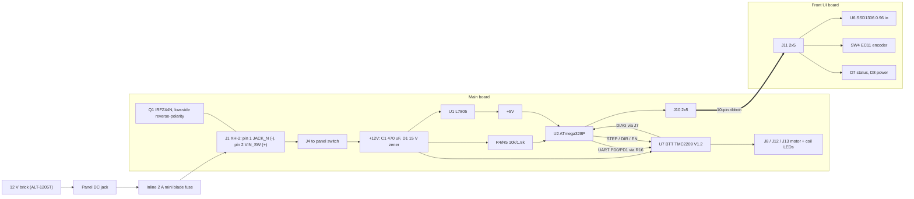

# Hardware reference (Rev A)

Compiled on 2026-10-14 from the two design chats (see `docs/history/sources.md`). It reflects the final schematic (Claude's v06, installed as `Universal motor driver v01.kicad_sch`) and the board as ordered (`Universal_motor_driver_v09_tabs.kicad_pcb`). Where the chats were ambiguous, this doc says so instead of guessing.

**The KiCad files are the authority.** Once they're in `hardware/kicad/`, check this doc against them and fix whichever is wrong. Known Rev A problems are in `docs/errata-rev-a.md`.

## Contents

1. [System overview](#1-system-overview)
2. [Boards and fabrication](#2-boards-and-fabrication)
3. [Power path](#3-power-path)
4. [MCU pin map](#4-mcu-pin-map)
5. [Driver module interface](#5-driver-module-interface)
6. [Connectors](#6-connectors)
7. [Front UI board and ribbon](#7-front-ui-board-and-ribbon)
8. [LEDs, test points, mounting](#8-leds-test-points-mounting)
9. [Bill of materials](#9-bill-of-materials)
10. [Layout rules used](#10-layout-rules-used)
11. [Silkscreen](#11-silkscreen)
12. [Display upgrade options](#12-display-upgrade-options)

## 1. System overview

A 12 V bench tester for bipolar stepper motors, NEMA 17 and smaller (4-, 6- and 8-wire; 5-wire unipolar is out). The main board carries power, the MCU, the driver and the motor connectors and sits open on a base. A small front board carries the OLED, the encoder and two LEDs, mounts to a front panel, and connects over a 10-pin ribbon.



| Block | Part |
|---|---|
| MCU | ATmega328P-PU, DIP-28 in two 14-pin sockets, 16 MHz crystal, programmed over ISP (no bootloader) |
| Driver | BigTreeTech TMC2209 V1.2 StepStick module, single-wire UART, address 0, R_SENSE 0.11 ohm (BTT's figure as found by Claude; not measured) |
| Display | SSD1306 128x64 I2C OLED module, 0.96 in, address 0x3C (board prints 0x78, the 8-bit form) |
| Input | EC11 rotary encoder with push switch |
| Supply | ALT-1205T 12 V brick; L7805 linear regulator for 5 V |
| Current range | up to about 1.77 A RMS (driver limit with 0.11 ohm sense); firmware allows 100 to 1750 mA |

## 2. Boards and fabrication

| Item | Value |
|---|---|
| Revision | Rev A, silkscreen `REV A 2026-10 -DK` |
| Main board | 100.635 x 89.0 mm (3.96 x 3.50 in), 2 layers |
| Front UI board | 70.0 x 38.11 mm (2.76 x 1.50 in), 2 layers |
| Panel | both boards in one outline, 2 mouse-bite tabs (2 mm wide) across a 2.0 mm slot; panel 100.63 x 129.11 mm (3.96 x 5.08 in) |
| Fab | JLCPCB. Recommended order setting: "Panel by customer", different designs: 2 (the progress doc records the order that way) |
| Stackup | recommended 2 layers, 1.6 mm, 1 oz copper, HASL (the settings actually chosen at checkout weren't recorded) |
| Quantity received | 5 boards, delivered 2026-10-12 |
| KiCad project | `Universal motor driver v01` (project file name has spaces) |
| Ordered board file | `Universal_motor_driver_v09_tabs.kicad_pcb`, installed under the project's root board name |
| Production zip | `production/`: inner `Universal_motor_driver_v01.zip` (gerbers + drills, the file JLC needs), `bom.csv`, `designators.csv`, `positions.csv` (LCSC part numbers blank) |

Gerber check before ordering (Claude's script on the production zip): one closed outline through both tabs; 12 mouse-bite holes of 0.5 mm in the NPTH file; 8 mounting holes of 3.2 mm NPTH; one 1.2 mm NPTH for J8's locating peg; 261 vias at 0.3 mm drill / 0.6 mm pad; smallest trace 0.2 mm; copper at least 0.5 mm from every edge; GND, +12V and F_GND pours filled. Two problems were flagged and their fix wasn't confirmed before ordering (errata E5, E6).

Routing: the owner routed both boards by hand. A clearance check on the main board found 0 violations at 0.2 mm across 537 tracks; it ran before the last connections, the front board and the pours were finished and wasn't repeated. Then a full top-layer GND pour plus 122 added GND vias (76 stitching, 46 grid), and GND vias for C18 to C21.

## 3. Power path

```
12 V brick -> panel jack -> inline 2 A blade fuse (+ wire) -> XH plug -> J1
J1 pin 2 VIN_SW -> J4 (panel switch) -> +12V
J1 pin 1 JACK_N -> Q1 drain;  Q1 source -> GND;  Q1 gate <- R1 10k <- +12V
```

- **J1 pin 1 is the NEGATIVE input (JACK_N), pin 2 is positive (VIN_SW).** It's backwards from the usual convention. The board's `+`/`-` marks at J1 are drawn at 0.064 mm and may not have printed (E6). Crimp the harness to match.
- **Reverse polarity:** Q1 (IRFZ44N) sits in the ground return. Plugged in backwards, Q1 stays off and nothing powers up. Q1's tab is its drain (JACK_N), so it is live: keep standoffs, screws and any grounded metal off it.
- **Fuse:** 2 A mini blade in an inline holder on the + wire. It's off-board on purpose; a series fuse can't be a do-not-populate footprint without breaking the net. Switch-on surge into C1 is about 0.34 A^2s (0.41 with C14), under the roughly 1 to 2 A^2s needed to melt a fast 2 A fuse, so slow-blow isn't required (estimate).
- **Switch:** any panel switch rated at least 2 A DC on J4. The KCD1-101 rocker (10 A at 125 V AC) was the planned part.
- **Rail protection:** C1 470 uF (25 V assumed from a photo of its drawer; read the can) is the first part after the switch. D1 (1N4744A, 15 V 1 W zener) clamps +12V; D5 (SMBJ15A TVS, SMB) is a do-not-populate upgrade spot beside it.
  - With D1 fitted, keep the input between 9 and 14 V. D1 starts conducting at 14.25 V (15 V - 5%), so a 19 or 24 V adapter burns D1 or blows the fuse. C1 and C14 are assumed to be 25 V parts (check the cans; the firmware's 25 V alarm assumes it).
- **5 V:** U1 L7805 (TO-220, tab = GND), C2 470 nF 50 V at the input, C3 100 nF + C4 10 uF at the output. Logic load estimate 40 to 70 mA, so 0.28 to 0.47 W in U1 at 12 V, 14 to 24 C rise, no heatsink (estimates).
- **Fan header J6:** +12V after the switch, live whenever the switch is on. Optional.
- **Worst-case input current:** 1.32 A design value (1.42 A with a 0.1 A fan), 71% of the 2 A fuse (estimates).
- **VM sense:** +12V -> R4 10k -> PC0 -> R5 1.8k -> GND, C10 100 nF at PC0, TP8 on the node. Ratio 1.8 / 11.8 = 0.1525; scale (10 + 1.8) / 1.8 = 6.556 x the ADC voltage; 0.032 V per count; 12.6 V reads 1.92 V at the pin; 29 V would read 4.42 V. The ADC reference is AVCC (the 7805 output), so the reading can be off by about +-0.48 V until trimmed in the firmware menu.
- **Ground:** there is no chassis ground. Measure and probe against board GND (TP3/TP4), never against the jack's minus, because Q1 sits between them.

## 4. MCU pin map

ATmega328P-PU (U2). The Arduino pin numbers are the same on an Uno, a Nano and the bare chip under MiniCore.

| Pin | Port | Arduino | Net / function | Connections |
|---|---|---|---|---|
| 1 | PC6 | RESET | RESET | R3 10k pull-up, D3 1N4148 clamp to +5V, SW2 reset button (DNP), J2 pin 5 |
| 2 | PD0 | D0 | UART RX | straight to the driver's PDN (module pads 12 + 13 tied), TP5 |
| 3 | PD1 | D1 | UART TX | R16 1k to PDN (single-wire UART) |
| 4 | PD2 | D2 | ENC_A (INT0) | 10k pull-up + 10 nF RC, J10 pin 6 |
| 5 | PD3 | D3 | ENC_B (INT1) | 10k pull-up + 10 nF RC, J10 pin 7 |
| 6 | PD4 | D4 | ENC_SW | 10k pull-up + 10 nF RC, J10 pin 8 (pressed = LOW) |
| 7 | VCC | | +5V | C5 100 nF |
| 8 | GND | | GND | |
| 9 / 10 | XTAL1 / XTAL2 | | 16 MHz | Y1, C6 / C7 22 pF |
| 11 | PD5 | D5 | LED_STAT | R10 1k, J10 pin 9, front D7 (red) |
| 12 | PD6 | D6 | DIR | U7 DIR, J5 pin 2, D13 yellow DIR LED via R21 1k |
| 13 | PD7 | D7 | EN (active LOW) | U7 EN, R8 10k pull-up (driver off during reset), J5 pin 3, D14 blue EN LED via R22 1k from +5V (lit when enabled) |
| 14 | PB0 | D8 | DIAG | J7 (jumper from the module's DIAG pin), TP7 |
| 15 | PB1 | D9 | STEP (OC1A) | U7 STEP, J5 pin 1, TP6 |
| 16 | PB2 | D10 | spare / debug TX | J9 pin 1 (firmware v1.0 sends its debug log here) |
| 17 / 18 / 19 | PB3 / PB4 / PB5 | D11 / D12 / D13 | MOSI / MISO / SCK | J2 ISP only |
| 20 | AVCC | | AVCC | +5V through L1 10 uH, C8 100 nF |
| 21 | AREF | | AREF | C9 100 nF |
| 22 | GND | | GND | |
| 23 | PC0 | A0 | VM sense | R4/R5 divider, C10, TP8 |
| 24 | PC1 | A1 | spare / buzzer | J9 pin 2; buzzer drive through R6 to Q2 (DNP) |
| 25 / 26 | PC2 / PC3 | A2 / A3 | spare | J9 pins 3 / 4 |
| 27 | PC4 | A4 | SDA | J10 pin 5; R18 4.7k pull-up (DNP) |
| 28 | PC5 | A5 | SCL | J10 pin 3; R17 4.7k pull-up (DNP) |

The three encoder lines each get a 10k pull-up (R13 to R15) and a 10 nF cap (C18 to C20), tau 100 us. The exact resistor/cap to line pairing isn't recorded consistently in the chats; read it from the schematic.

## 5. Driver module interface

U7 is a BTT TMC2209 V1.2 StepStick on two 1x8 female headers, logic pins on one side and power pins on the other. Footprint pad numbers (KiCad, Pololu 16-pin breakout style) and module labels:

| Pad | Module pin | Net | Pad | Module pin | Net |
|---|---|---|---|---|---|
| 9 | EN | PD7 (R8 10k to +5V) | 8 | VM | +12V, C14 100 uF |
| 10 | MS1 | GND | 7 | GND | GND |
| 11 | MS2 | GND | 6 | motor | MOT_A2 |
| 12 | PDN/UART | PD0, and PD1 via R16 | 5 | motor | MOT_A1 |
| 13 | PDN/UART | tied to pad 12 | 4 | motor | MOT_B1 |
| 14 | CLK | GND (internal oscillator) | 3 | motor | MOT_B2 |
| 15 | STEP | PB1 | 2 | VIO | +5V, C21 100 nF |
| 16 | DIR | PD6 | 1 | GND | GND |

- MS1 = MS2 = GND sets UART address 0.
- Both PDN pads are tied because, per BTT's FAQ as Claude read it, BTT bridges the UART to one header pin and other brands use the other; tying both covers either way.
- The driver only answers on UART when VM is powered (BTT FAQ; the firmware's self test assumes it).
- **DIAG is not on the 16-pin footprint.** It's a separate pin on the module, linked to PB0 by a jumper wire onto J7. J7 sits under the module at the pad 1/16 end (y 66.67 mm), but on the owner's module DIAG is at the EN/VM end (y 48.9 mm). See E1.
- Silkscreen marks `EN` and `VM` just outside the module outline at pads 9 and 8. A StepStick plugged in backwards dies on power-up.
- Leave clearance above the module for its heatsink.

## 6. Connectors

| Ref | Function | Part / footprint | Pinout |
|---|---|---|---|
| J1 | 12 V in | JST XH 2-pin vertical | 1 JACK_N (-), 2 VIN_SW (+) |
| J4 | panel switch (`SW`) | JST XH 2-pin | 1 VIN_SW, 2 +12V (no polarity at the switch) |
| J6 | fan (`FAN 12V`), optional | JST XH 2-pin | 1 +12V, 2 GND |
| J2 | ISP (`ISP`) | 2x3, 2.54 mm; footprint is a shrouded IDC box header (E2) | 1 MISO (PB4), 2 VCC (via J3), 3 SCK (PB5), 4 MOSI (PB3), 5 RESET (PC6), 6 GND |
| J3 | ISP power jumper (`ISP PWR`, `OFF W/ 12V`) | 1x2 header + shunt | connects J2 pin 2 to +5V. On only when the programmer powers the board; **off whenever the brick is plugged in** (two 5 V sources would fight) |
| J5 | STEP/DIR/EN tap | 4-pin; planned as a 2.54 mm header, but Claude's read of the board file (2026-10-13) lists it as JST XH: check | 1 STEP (PB1), 2 DIR (PD6), 3 EN (PD7), 4 GND. Shares nets with U7; pull U7 before driving an external driver from it |
| J7 | DIAG link | 1-pin header | to PB0; jumper from the module's DIAG pin (E1) |
| J8 | motor | JST XH 4-pin, footprint is the "AM" variant with a locating-peg hole (a plain B4B-XH-A fits; the hole stays empty) | 1 B2, 2 B1, 3 A1, 4 A2 |
| J12 | motor | 1x4 pin header, 2.54 mm | same as J8 |
| J13 | motor | 4-position screw terminal, 5.08 mm (Phoenix MKDS footprint) (E3) | same as J8 |
| J9 | spare GPIO / debug | 1x6, 2.54 mm | 1 PB2, 2 PC1, 3 PC2, 4 PC3, 5 +5V, 6 GND |
| J10 | ribbon to front board (`TO UI`) | 2x5, 2.54 mm; IDC box-header footprint (E2) | see section 7 |
| J11 | ribbon on the front board (`TO MAIN`) | 2x5 on the front board's back side; IDC box-header footprint (E2) | see section 7 |

**Motor connectors J8, J12 and J13 are wired in parallel.** One motor at a time. Pins 1-2 must be one coil and pins 3-4 the other. Never plug or unplug a motor with 12 V on; the inductive kick kills TMC2209s.

## 7. Front UI board and ribbon

The front board's nets all start with `F_` and only connect to the main board through the ribbon. J10 is on the top of the main board; J11 is on the back of the front board so the cable exits behind the panel. Use a straight 10-wire ribbon, red stripe on pin 1 at both ends, keyways the same way.

| Pin | J10 (main) | J11 (front) | Front part |
|---|---|---|---|
| 1 | +5V | F_5V | U6 VCC |
| 2 | GND | F_GND | grounds |
| 3 | PC5 (SCL) | F_SCL | U6 SCL |
| 4 | GND | F_GND | grounds (shields SCL from SDA) |
| 5 | PC4 (SDA) | F_SDA | U6 SDA |
| 6 | PD2 (ENC_A) | F_ENC_A | SW4 A |
| 7 | PD3 (ENC_B) | F_ENC_B | SW4 B |
| 8 | PD4 (ENC_SW) | F_ENC_SW | SW4 switch S1 |
| 9 | LED_STAT (from PD5 via R10 1k) | F_LED_STAT | D7 red anode |
| 10 | LED_PWR (from +5V via R11 1k) | F_LED_PWR | D8 green anode |

- **U6, OLED:** soldered directly to a 1x4 pin header footprint (not socketed: by Claude's height estimates a socket makes the stack too tall for the encoder bushing to reach the panel). Pin order GND, VCC, SCL, SDA. Some modules swap GND and VCC; check the module's silkscreen before soldering, reversed power kills them. The module body (27.3 x 27.8 mm) is drawn on F.Fab.
- **SW4, EC11:** A, C (common, F_GND), B on the 3-pin side; S1 / S2 (F_GND) on the 2-pin side; two mounting tabs in 1.5 mm slots (E5). The encoder nut on the panel is a mounting point too.
- **I2C pull-ups:** modules like this usually have their own (not checked on this one; the resistor code reads 472 for 4.7k, 103 for 10k). R17/R18 (4.7k) on the main board are DNP; fit them only if the display is flaky over the ribbon. The firmware tries 400 kHz and falls back to 100 kHz.

## 8. LEDs, test points, mounting

| Ref | Colour / type | Meaning |
|---|---|---|
| D7 | red, 5 mm (front) | status LED, driven by PD5 |
| D8 | green, 5 mm (front) | power, on with +5V |
| D9 / D10 | red / green 0805 pair across the coil B outputs | driver output voltage, one colour per polarity |
| D11 / D12 | red / green 0805 pair across the coil A outputs | same |
| D13 | yellow 0805 | DIR (PD6 high) |
| D14 | blue 0805 | EN: lit when the driver is enabled (PD7 low). Dark during most of the self test is normal |

- Coil LED pairs are wired back to back on purpose; don't "fix" one during assembly. They sit on the board side of the motor connectors, so they show the driver switching its outputs, not current reaching the motor: an open motor lead still lights its pair. R19 (MOT_B1 side) and R20 (MOT_A1 side) are 4.7k: (10 V)^2 / 4700 = 21 mW each.
- D13: (5 - 2.0) / 1000 = 3 mA. D14: (5 - 3.0) / 1000 = 2 mA.

Test points (Keystone 5000-5004 miniature loops; references hidden, function labels printed):

| TP | Label | Net |
|---|---|---|
| TP1 | 12V | +12V |
| TP2 | 5V | +5V (next to U1) |
| TP3 | GND | GND |
| TP4 | GND | GND (opposite end) |
| TP5 | PD0 | UART / PDN |
| TP6 | PB1 | STEP |
| TP7 | DIAG | PB0 |
| TP8 | VM SENSE | divider node |

Mounting holes: H1 to H4 on the main board, H5 to H8 on the front board, all M3 (3.2 mm NPTH, no net).

## 9. Bill of materials

On-board parts by reference. DNP = footprint only. Values are from the final schematic as discussed in the chats; inventory notes come from Claude's audit of the owner's inventory file on 2026-10-13.

| Ref | Value | Footprint / package | Notes |
|---|---|---|---|
| U1 | L7805CV | TO-220 vertical | tab = GND |
| U2 | ATmega328P-PU | DIP-28 | two 14-pin sockets end to end (no 28-pin socket in stock) |
| U6 | SSD1306 0.96 in I2C module | 1x4 pin header | front board |
| U7 | BTT TMC2209 V1.2 | 2x 1x8 female header | module, with heatsink |
| Y1 | 16 MHz crystal | HC-49/S (Crystal_HC49-4H_Vertical) | 3.3 mm tall |
| Q1 | IRFZ44N | TO-220 vertical | reverse polarity, tab live (JACK_N) |
| L1 | 10 uH | 0805 (resistor pads) | not in inventory (E4) |
| C1 | 470 uF, 25 V assumed | radial D10 P5.00 | 10.2 mm can, 5 mm leads; read the rating on the can |
| C14 | 100 uF, 25 V assumed | radial D6.3 P2.50 | Wurth, at VM; read the rating on the can |
| C2 | 470 nF 50 V | 0805 | U1 input (datasheet asks 0.33 uF min) |
| C3, C5, C8, C9, C10, C21 | 100 nF 50 V X7R | 0805 | U1 out, VCC, AVCC, AREF, VM sense, VIO |
| C4 | 10 uF 25 V X7R | 0805 | U1 output |
| C6, C7 | 22 pF | 0805 | crystal load caps (should be C0G/NP0; check) |
| C18, C19, C20 | 10 nF 50 V X7R | 0805 | encoder RC |
| R1, R3, R4, R8, R13, R14, R15 | 10k | 0805 | Q1 gate, reset, VM divider top, EN pull-up, encoder pull-ups |
| R5 | 1.8k | 0805 | VM divider bottom |
| R10, R11, R16, R21, R22 | 1k | 0805 | status LED, power LED, UART TX, DIR LED, EN LED |
| R19, R20 | 4.7k | 0805 | coil LEDs |
| R17, R18 | 4.7k | 0805 | I2C pull-ups, **DNP** |
| D1 | 1N4744A 15 V 1 W zener | DO-41 | +12V clamp |
| D3 | 1N4148 | DO-35 | reset clamp |
| D5 | SMBJ15A TVS | SMB | **DNP** |
| D7, D8 | red, green | 5 mm THT | front board |
| D9 to D12 | red / green pairs | 0805 LED | coil indicators |
| D13, D14 | yellow, blue | 0805 LED | DIR, EN |
| SW2 | 6 mm tact switch | THT | reset, **DNP** |
| SW4 | EC11 with switch | Alps EC11E vertical | front board |
| BZ1, Q2, R6, R7, D6 | 12 mm active buzzer, S8050 (TO-92), 1k, 10k, 1N4148 | | buzzer circuit on PC1, all **DNP** (check S8050 pin order E-B-C before fitting) |
| J1, J4, J6 | JST XH 2-pin | B2B-XH-A vertical | power in, switch, fan |
| J8 | JST XH 4-pin | B4B-XH-AM footprint | motor |
| J12 | 1x4 header | 2.54 mm | motor |
| J13 | 4-pos screw terminal | 5.08 mm | motor (E3) |
| J2 | 2x3 | IDC box-header footprint | ISP (E2) |
| J10, J11 | 2x5 | IDC box-header footprint | ribbon (E2) |
| J3 | 1x2 + shunt | 2.54 mm | ISP power jumper |
| J5 | 4-pin | JST XH per the board file (planned 2.54 mm header): check | STEP/DIR/EN tap |
| J7 | 1x1 | 2.54 mm | DIAG link (E1) |
| J9 | 1x6 | 2.54 mm | spare GPIO |
| TP1 to TP8 | test loop | Keystone 5000-5004 miniature | |
| H1 to H8 | M3 | 3.2 mm NPTH | |

Off-board: panel DC jack (5.5 x 2.1 mm planned; fit with the brick's plug not yet confirmed), inline mini-blade fuse holder + 2 A fuse, panel switch (at least 2 A DC), optional 30 mm 12 V fan, XH housings and crimps, 22 AWG wire, 10-wire ribbon with two FC-10 IDC sockets, M3 standoffs and screws.

## 10. Layout rules used

| Item | Rule |
|---|---|
| Net class Power | 1.0 mm track, 0.25 mm clearance, 0.8 / 0.4 mm vias; patterns `+12V`, `GND`, `*MOT_*`, `*JACK_N`, `*VIN_SW` (the `*` catches the sheet prefix, e.g. `/MOT_A1`) |
| Default class | 0.2 mm clearance; signals 0.25 mm |
| JACK_N | 2.0 mm |
| +5V trunk, AVCC feed, F_5V | 0.5 mm |
| Vias | 0.6 / 0.3 mm signal; two 0.8 / 0.4 mm wherever a Power net changes layer (about 2.2 A per via, estimate) |
| Pours | top: +12V zone priority 1, GND priority 0; bottom: solid GND; 0.3 mm clearance, 0.5 mm thermal spokes; front board: F_GND both layers |
| Crystal | short, equal traces; nothing under it on either layer; no vias on XTAL nets; GND guard pour |
| Power width math | IPC-2221, 2 A, 1 oz, 10 C rise: 0.78 mm, rounded up to 1.0 mm |

## 11. Silkscreen

- Main board ID: `UNIVERSAL STEPPER TESTER` / `REV A  2026-10  -DK`. Front board, back side: `UI  REV A  -DK`. The silkscreen is signed "-DK" (the owner's choice over "Krech Protolab"); the schematic title block still lists company "Krech Protolab".
- Section titles `POWER`, `DRIVER`, `MCU`; `12V IN` with `+`/`-` at J1; `SW`; `FAN 12V`; `ISP`; `ISP PWR` / `OFF W/ 12V`; `EN` / `VM` at the module; `DIAG`; `STEP DIR EN GND` at J5; `PB2 PC1 PC2 PC3 5V GND` at J9; `B2 B1 A1 A2` at J12/J13; `COIL A` / `COIL B`; `NO HOT PLUG`; `TO UI` / `TO MAIN`; TP function labels.
- Panel labels such as `PWR` and `STATUS` belong on the laser-cut front panel, not the board.

## 12. Display upgrade options

The 0.96 in OLED works but is small. Research from 2026-10-14 (Claude's reading of seller pages; nothing chosen or bought yet):

| Screen | Size vs now | Module | Power | Interface | Fits on U6? |
|---|---|---|---|---|---|
| 0.96 in SSD1306 (current) | 1.0x | 27.3 x 27.8 mm | 5 V ok | I2C | yes |
| 1.3 in SH1106 | 1.35x | 35 x 33 mm | 3.3 to 5 V | I2C, 4-pin | no, hits the H5/H7 standoffs |
| 1.54 in SSD1309 (Waveshare) | 1.60x | 43 x 37.5 mm | 3.3 / 5 V, level shifting on board | SPI default, I2C supported | no, panel mount |
| 2.42 in SSD1309 | 2.52x | 72 x 43.5 mm | 2.8 to 3.3 V only | SPI default, I2C by moving resistors | no, bigger than the front board |

- Any upgrade must stay I2C: the ribbon only carries SCL, SDA, 5V and GND for the display.
- Recommended approach: panel-mount the screen and run 4 wires to U6's pads.
- Claude's pick was the 1.54 in Waveshare; the 2.42 in needs a 3.3 V regulator (AMS1117-3.3, in stock, off F_5V), leaves little logic-high margin, and R17/R18 must stay empty with it.
- One 1.3 in seller lists the pins as VCC, GND, SCL, SDA; ours is GND, VCC, SCL, SDA. Check every module's pin order.
- Firmware impact: v1.0 has its own SSD1306 driver, so any other controller (SH1106, SSD1309) means a firmware change and a test on the real module.
